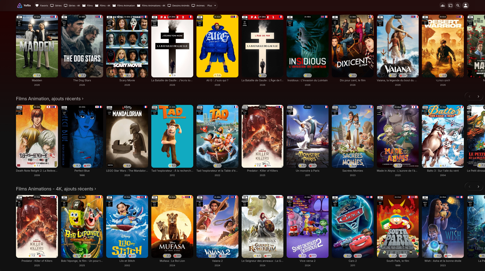
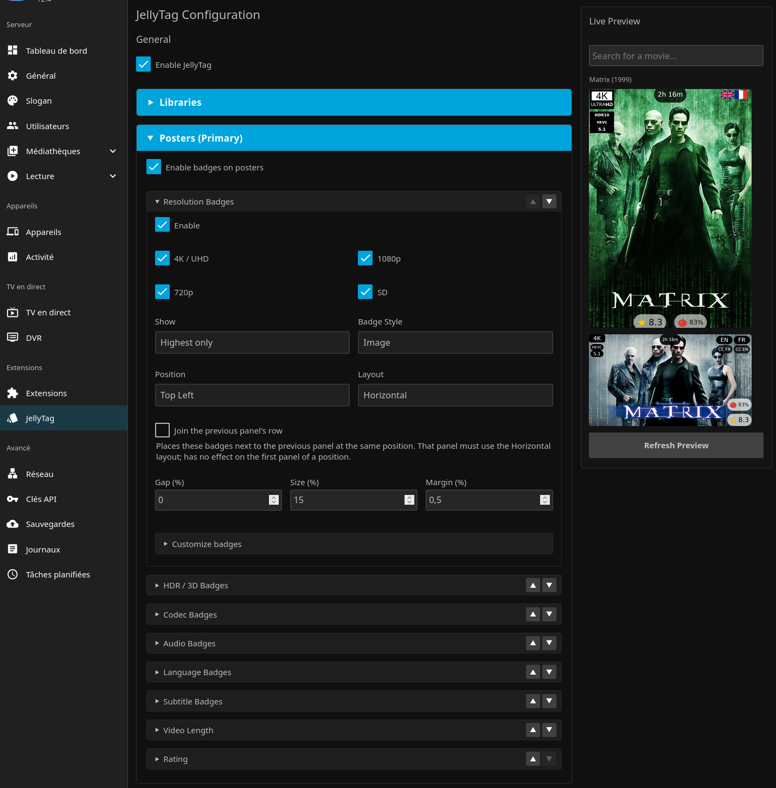

# JellyTag

  

<!--toc:start-->

- [Compatibility](#compatibility)
- [Features](#features)
- [Screenshots](#screenshots)
- [Installation](#installation)
- [Configuration](#configuration)
- [Custom badges](#custom-badges)
- [How it works](#how-it-works)
- [Troubleshooting](#troubleshooting)
- [Contributing](#contributing)

<!--toc:end-->

Jellyfin plugin that overlays quality badges (resolution, HDR, codec, audio,
language) on your media posters and thumbnails. Badges are rendered
server-side, so they appear on **all Jellyfin clients** without any client
configuration.

## Compatibility

| JellyTag | Jellyfin                             |
| -------- | ------------------------------------ |
| 3.x      | 12.x (built and tested against 12.4) |
| 2.x      | 10.11 (not maintained)               |

## Features

- **Multi-category badges**: resolution, HDR and Dolby Vision, video codec,
  audio, language flags and VOST indicator.
- **All clients**: badges are drawn on the server, not in the client.
- **Per image type**: independent settings for posters and thumbnails.
- **Per category panels**: position, layout, order, size, colors, and "highest
  only" or "all" display mode.
- **SVG or text badges**, with customizable colors, opacity and corner radius.
- **Custom badges**: replace any default badge with your own SVG, PNG or JPEG.
- **Live preview** in the configuration page.
- **Library filtering**, **configuration export/import**, **disk cache**.

## Screenshots

## Installation

1. In the Jellyfin dashboard, add this plugin repository:
   `https://raw.githubusercontent.com/Atilil/jellyfin-plugins/main/manifest.json`
2. Install **JellyTag** from the plugin catalog, then restart Jellyfin.

## Configuration

The settings are on the plugin page in the Jellyfin dashboard:

- **Global**: enable JellyTag, output format (JPEG or WebP), JPEG quality,
  cache duration, excluded libraries.
- **Posters and thumbnails**: each image type has its own panels; thumbnails
  can mirror the poster settings with a size reduction.
- **Panels** (resolution, HDR, codec, audio, language): enabled, corner,
  horizontal or vertical layout, image or text style, size, margin and gap (as
  a percentage of the image), display mode, order, text colors.

## Custom badges

Any default badge can be replaced by your own image, or by a custom text for
text-style badges:

- in the **Custom Badges** section of the configuration page;
- or through the API: `POST /JellyTag/CustomBadge/{badgeKey}` to upload,
  `DELETE` on the same path to revert to the default.

Custom badges are stored in Jellyfin's data folder (`<data>/jellytag`) and
survive plugin updates. Rendered images are cached in Jellyfin's cache folder
(`<cache>/jellytag`).

## How it works

JellyTag intercepts Jellyfin image requests, reads the media quality from the
item metadata, draws the badges onto the image (SkiaSharp, with the libraries
bundled in Jellyfin) and caches the result on disk.

## Troubleshooting

- **Badges not appearing**: check that the plugin and the badge categories are
  enabled, then clear the browser cache and the plugin image cache.
- **Clearing the cache**: "Clear Image Cache" button in the configuration page.
- **Performance**: increase the cache duration, lower the JPEG quality, disable
  the badge categories you do not need.

## Contributing

See [CONTRIBUTING.md](CONTRIBUTING.md).

---

_This plugin is developed with AI assistance (Claude)._
